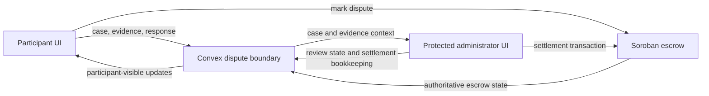

# Highrable Instawards Deliverable 3 — Implementation Review

## Executive summary

This review covers the commit ancestry from baseline b55741894d2d127d81aea484f1f4b55fb049cba5 through HEAD bd169f860a69b97f72e47b995a14df73821ac9d8 (bd169f8, 2026-10-16). The range contains 65 descendant commits: 24 non-merge commits and 41 merge or synchronization commits. The aggregate tree diff changes 77 files, with 12,067 insertions and 472 deletions.

Deliverable 3 is a baseline-aware integration and hardening slice. Participant dispute creation, list/detail routes, evidence and response forms, timeline, route guards, and transaction-state UI were already present before this range. The main work in this range makes the participant/admin contract safer and easier to verify:

- Convex re-resolves the current work and participant graph when reading a dispute or accepting participant evidence and responses.
- Evidence is checked against the exact dispute, current participants, uploader role, and active attachment state.
- Participant response retries can be idempotent when the caller supplies a request ID.
- Marking callbacks avoid a new on-chain attempt when a transaction hash is already saved and still requires reconciliation.
- The administrator consumer rejects inconsistent case/parent data, gives reviewers clearer evidence states, and validates a successful settlement against the saved attempt.
- Soroban contract tests lock participant marking authorization, event shape, address variants, and rejected-call side effects. The production escrow contract itself did not change in this range.
- Local test reports include broad Convex, web, Soroban, and CLI coverage. They do not establish a live Testnet lifecycle or formal SOW completion.

This document describes code and evidence present in the reviewed range. Test totals below are dated snapshots from checked-in reports; they are not a fresh test run for this documentation change and must not be added together.

## Review scope and accounting

| Item | Reviewed value |
| --- | --- |
| Baseline | b55741894d2d127d81aea484f1f4b55fb049cba5, 2026-10-13 09:36 +08 |
| Reviewed HEAD | bd169f860a69b97f72e47b995a14df73821ac9d8, 2026-10-16 10:37 +08 |
| Descendant commits | 65 |
| Non-merge commits | 24 |
| Merge and synchronization commits | 41 |
| Files changed | 77 |
| Aggregate diff | 12,067 insertions, 472 deletions |
| Review sources | Git history and source diff, Deliverable 3 sprint plan, SOW, vault notes, and checked-in evidence reports |

The range is ancestry-based and excludes the baseline commit itself. I reviewed the final source diff and the 24 substantive non-merge commits individually. I also checked all 41 merge commits as branch integration history; their abbreviated IDs and pull-request or synchronization labels are listed in the final section. The checked-in test evidence is cited as reported evidence, not as an independent rerun.

## Highrable before this deliverable

At b5574189, Highrable already had a working dispute product slice across the participant UI, Convex, Soroban, and the protected administrator interface. The Deliverable 3 sprint plan explicitly records that participant case creation, list/detail, evidence, responses, timeline, marking feedback, route guards, and local tests existed before the sprint. The SOW's prior impact snapshots also describe participant and administrator workflows as established foundations.

| Layer | State at the baseline |
| --- | --- |
| Participant interface | Dispute routes and feature components already supported opening a case, participant-scoped list/detail, evidence, responses, timeline, status feedback, and access/error states. The sprint plan called for hardening and integration against real gaps, not rebuilding these surfaces. |
| Convex dispute workflow | Dispute records, participant/admin queries and mutations, parent and evidence validation, statuses, events, notifications, and transaction bookkeeping already existed. The range still found gaps in rechecking the live parent/participant graph on reads and writes, exact evidence attachment association, response replay protection, and complete acceptance snapshots. |
| Soroban | The escrow contract already exposed participant dispute marking and the larger dispute/settlement state machine. Marking behavior and events were implemented in contract source before the range; there was a need to freeze the consumer handoff and expand authorization, event, address-kind, and no-side-effect tests. |
| Administrator interface | Protected queue/detail, session checks, review controls, settlement coordination, and basic evidence display were already present. The range strengthened record consistency, linked-record context, evidence availability states, cross-interface acceptance, and settlement-result validation. |
| Deployment and proof | Source and local tests were not equivalent to a verified live deployment. The repository did not yet have evidence for five complete Testnet dispute lifecycles, a complete transaction-link set, or a reviewer-ready package. |

The baseline is therefore not an empty or nonfunctional dispute module. Deliverable 3 primarily tightens the trust boundaries and the connections among participant activity, Convex records, contract outcomes, and administrator review.

## Highrable after this deliverable

At bd169f8, the participant workflow remains built on its existing routes and components, while important backend and administrator boundaries are stricter and more thoroughly exercised.

### Participant and backend boundary

- A shared Convex resolver reconstructs the dispute's current parent work and participants. Reads, participant responses, and evidence writes fail closed when the parent is missing, the current participants differ from the saved dispute, or populated saved links conflict with the current job, micro-gig, milestone, escrow, or on-chain escrow.
- Explicit escrow references are resolved in context rather than silently replaced by a different escrow found through a parent lookup.
- Protected dispute attachments must be active, associated with the exact dispute, uploaded by the participant named by the owner role, and viewed by a currently authorized participant. Invalid or revoked historical evidence is omitted or denied.
- Administrator evidence resolution applies the same case association and participant-uploader constraints before returning an attachment URL.
- getAttachmentAccessLogs now denies a stale former attachment owner when the dispute's current attachment policy does not allow viewing. It retains the existing not-found response shape.
- addDisputeResponse accepts an optional request ID, trims it, rejects blank or over-128-character values, and records it on the event. A matching retry for the same dispute and actor returns success without writing another event or notification. A conflicting reuse of the key rejects. Calls that omit a request ID retain the older non-idempotent behavior.
- The response replay index is additive: the request ID is optional and existing events need no backfill. The schema/index change does not add a new dispute status or change the mutation's boolean result.
- Marking bookkeeping rejects a new not_marked start if a transaction hash is already recorded. The participant must reconcile that known transaction instead of submitting another. Existing mark_failed known-hash protection, matching-success idempotency, conflicting callback rejection, late-success recovery, and stale-failure suppression remain covered.

### Soroban marking contract and tests

No production contract source or public contract method changed between the baseline and HEAD. Tests and handoff documentation now freeze the existing mark_disputed(caller, escrow_id) contract: eligible callers and entry states, authorization errors versus returned errors, event topics and payload, and expected state effects.

The tests cover client/freelancer and owner authorization, registered dispute administrators not receiving participant marking rights from membership alone, outsider and mismatched invocation rejection, Funded and Submitted entry states, invalid and repeated statuses, account (G...) and contract (C...) address combinations, and exact no-side-effect snapshots. Rejected marking calls are checked for unchanged escrow records, balances, reputation, ID allocation, and event counts. These are Soroban host tests; they do not prove a real wallet signature or deployed behavior.

### Administrator consumer and settlement result

- The administrator API checks that a fetched dispute detail matches the requested case ID and that the returned dispute, parent, job, milestone, and escrow references do not contradict one another. An inconsistent result produces a generic 409 error before it can be cached or rendered.
- The protected detail view identifies the opener and canonical work context, labels unavailable linked records, and separates case evidence from timeline evidence.
- Evidence review distinguishes available, missing, blocked, deleted, invalid, and URL-unavailable attachments. Linked submission, revision, message, and deadline IDs are shown as references only; the page does not fetch or invent their protected content.
- The administrator settlement API validates successful result shapes, including terminal status, basis points, nonnegative finite payout/refund amounts, a 64-character hexadecimal transaction hash, and an HTTPS Stellar Expert URL.
- The settlement coordinator compares final or recovered success against the saved operation's resolution status, share, and normalized transaction hash. A malformed or mismatched result does not become success and does not trigger a second Stellar execution during read recovery.
- Integration suites exercise participant opening/evidence, protected admin review, participant-visible review-state changes, and all three terminal settlement outcomes through typed test fixtures and mocked transports.

### Participant-facing transaction states

The participant detail and marking-status surfaces continue to distinguish chain confirmation from unfinished Convex recording and from unknown outcomes. Confirmed chain state takes precedence over an older local pending outcome, while a saved transaction hash in not_marked or mark_failed is presented as requiring reconciliation. The UI explicitly tells the participant not to submit another transaction while confirmation bookkeeping is incomplete.

The browser-facing participant work in this range is modest because the core workflow predated the baseline. Related D2 fixes included in the same ancestry also improved route recovery after wallet changes, saved-case reopening, and marking confirmation/retry messaging. These changes are accounted for separately in the commit ledger.

## End-to-end relationship

The intended trust and data flow can be read as:

1. A client or freelancer opens or revisits a dispute through the participant routes.
2. Convex derives the case's canonical work and current participant context before protected reads and evidence/response writes.
3. Participant evidence and responses become dispute-scoped attachments and events; keyed responses can be safely retried.
4. For on-chain marking, the browser records local/Convex transaction phases around the existing Soroban call. Soroban remains authoritative for escrow state, and known hashes go through reconciliation rather than blind resubmission.
5. The protected administrator queue consumes the same dispute identity and work links. Its API and evidence renderer reject contradictory or unavailable context.
6. Administrator review and resolution results are accepted only when their saved identity and state match. Participant subscriptions and cross-interface propagation are exercised in local integration tests.

The participant-to-admin and admin-to-participant integration evidence uses mocked HTTP, Convex, upload, subscription, wallet, and Stellar seams. It demonstrates frontend coordination under the tested fixtures, not live service propagation.

## Before and after comparison

| Capability | Before b5574189 | At bd169f8 |
| --- | --- | --- |
| Participant case flow | Existing creation, list/detail, evidence, responses, timeline, route guards, and transaction feedback. | Existing UI is retained; route/recovery behavior and transaction messaging have adjacent regression fixes, and backend assumptions are more explicitly tested. |
| Current parent and participant checks | Base authorization and creation validation existed, but protected read/write coverage did not consistently re-resolve every saved dispute against the current parent graph. | Protected dispute reads and participant evidence/response actions resolve current parent and participant state and fail closed on deleted, reassigned, or contradictory records. |
| Evidence | Evidence support and ownership checks existed. | Evidence and historical attachments are checked against the exact case, active state, current participant uploader, and current authorization. Admin sees explicit availability states. |
| Response retry | Responses created events and notifications; safe application-level request-key replay was absent. | Optional request IDs make matching retries write-free and conflicting key reuse atomic. Omitted IDs remain compatible with legacy behavior. |
| On-chain marking | Contract and callback state machine existed. | Known hashes block blind new attempts; tests cover recovery/replay boundaries and Soroban authorization/event/side-effect invariants. |
| Administrator case data | Protected admin queue/detail and review flow existed. | Case identity and linked work are checked before cache/render; evidence and linked-record presentation is more explicit; review propagation is covered end to end with mocked interfaces. |
| Settlement result | Admin settlement coordination and recovery existed. | Successful result validation is tied to the saved outcome, share, and transaction hash; malformed or mismatched results do not produce false success. |
| Verification | Local suites covered existing paths, with gaps in cross-layer and rejection snapshots. | Dated reports document expanded acceptance matrices across backend, web, Soroban, and verifier CLI; live Testnet/reviewer proof remains open. |

## Effect on the whole Instawards sprint

Deliverable 3 is the participant-facing integration point for the broader dispute sprint. Its effect reaches the other SOW workstreams as follows:

| SOW workstream | Deliverable 3 contribution in this range | Sprint effect and remaining boundary |
| --- | --- | --- |
| Deliverable 1 — Soroban contract | Freezes the existing participant marking contract and adds tests for address kinds, role/state authorization, event shape, and rejected-call atomicity. | Reduces uncertainty for participant and backend callers. No contract production source or deployment changed in this range, so these tests do not establish deployed Testnet behavior. |
| Deliverable 2 — Convex backend | Adds current-parent access checks, exact evidence association, keyed response replay, a known-hash reconciliation guard, and connected participant acceptance coverage. Six D2 follow-up commits also improve wallet-change routes, historical evidence validation, admin navigation state, marking recovery, verifier code-lifetime checks, and saved-case reopening. | Makes the backend a safer source for participant and admin workflows. Caller-supplied wallet addresses remain identifiers and are not cryptographic proof of wallet possession. |
| Deliverable 3 — Participant interface | Keeps the existing participant feature slice aligned to backend and contract state, and adds or strengthens transaction-state feedback and acceptance links where gaps were identified. | Completes a stronger local participant-to-review path without duplicating baseline functionality. The formal participant branch, merged participant PR, reviewer deployment, screenshots, and recording required by the SOW are not established by this commit range. |
| Deliverable 4 — Administrator interface | Adds case-reference consistency checks, clearer evidence and linked-record presentation, review-state integration coverage, cross-interface acceptance, and successful settlement-result validation against the saved attempt. | Improves the reviewer-side handoff from participant cases. This is still local/mocked evidence and does not establish a live administrator deployment or settlement. |
| Deliverable 5 — Automated testing and Testnet validation | Adds broad local Convex, web, Soroban, and deployment-verifier suites, including negative authorization and rejected-write snapshots. | Checked-in snapshots exceed the SOW's raw 20-test count in individual packages, but the range does not include a consolidated current category-by-category report or evidence of five complete live Testnet lifecycles and all settlement outcomes. |
| Deliverable 6 — Reviewer evidence package | Adds contract/API handoffs and evidence notes for the C01–C23 items addressed in this range, alongside earlier baseline and D2 evidence. | Makes implementation easier to audit. The full reviewer package still needs the SOW-required branch/PR evidence, verified deployment identity, transaction links, reviewer deployment, screenshots, and concise demo recording. |

Overall, Deliverable 3 reduces integration risk across the sprint: participants, administrators, Convex, and Soroban now share more explicit and testable expectations for case identity, evidence, status, and transaction recovery. It advances the end-to-end product slice, but does not complete every SOW deliverable or its live acceptance criteria.

## Validation evidence recorded in the repository

These are dated results from the evidence documents, not a unified run performed for this review. Different reports represent different snapshots and must not be summed.

| Area | Recorded result | Source and boundary |
| --- | --- | --- |
| Backend contract and API | C02 reports 62 focused API/schema/index tests and 364 backend tests across 13 files. C22 later reports 18 focused acceptance tests and 497 backend tests across 17 files. | [C02 API contract evidence](./Deliverable-3-C02-Participant-API-Contract-Evidence.md), [C22 participant acceptance evidence](./Deliverable-3-C22-Participant-Acceptance-Evidence.md). Local Convex tests do not prove wallet possession or deployed Convex behavior. |
| Protected backend reads/evidence | C10 reports 13 focused tests and 381 backend tests across 14 files. | [C10 evidence](./Deliverable-3-C10-Evidence.md). Storage and live service behavior remain unverified. |
| Participant responses | C14 reports 74 focused tests and 456 backend tests across 15 files. | [C14 response evidence](./Deliverable-3-C14-Participant-Response-Evidence.md). Calls without request IDs intentionally retain legacy non-idempotent behavior. |
| Marking recovery | C18 reports 23 focused tests and 479 backend tests across 16 files. | [C18 reconciliation evidence](./Deliverable-3-C18-Participant-Marking-Reconciliation-Evidence.md). RPC is mocked; there is no new live reconciliation service. |
| Soroban | C17 reports 83 escrow tests and 9 reputation tests, with contract build and formatting checks recorded as passing. | [C17 address authorization evidence](./Deliverable-3-C17-Participant-Address-Authorization-Evidence.md). This is local host authorization and build evidence, not wallet signature or deployment proof. |
| Administrator UI | C23 reports 252 focused tests and 486 web tests across 29 files, plus TypeScript, lint/format, and Next.js production build checks. | [C23 resolution result evidence](../obsidian/evidence/C23-Administrator%20Resolution%20Result%20Evidence.md). Browser, API, and subscriptions are mocked. |
| Cross-interface flow | C19 reports 7/7 focused tests and a later full web run of 450/450 across 29 files. C23 records the later 486/486 full web run. | [C19 cross-interface evidence](../obsidian/evidence/C19-Participant-to-Administrator%20Acceptance%20Evidence.md). This does not prove live Convex publication, uploads, wallet signatures, or chain settlement. |
| Deployment identity CLI | C21 reports 57 tests for the read-only verifier using synthetic WASM and a loopback RPC fixture. | [C21 verifier evidence](./Deliverable-3-C21-Deployment-Identity-CLI-Evidence.md). Production WASM provenance and live Testnet identity remain unverified. |

Some intermediate web snapshots recorded two stale participant text assertions failing: C07 reported 421/423, C11 427/429, and C15 438/440. The later C19 report records those assertions passing in a 450/450 full run, and C23 records 486/486. These are chronological suite snapshots, not contradictory claims about one run.

## Remaining acceptance gaps

- Participant mutations still accept caller-supplied wallet addresses. The backend validates role and current parent relationships but does not thereby prove that the caller controls the address.
- Cross-interface tests use mocked HTTP/session, Convex, uploads, subscriptions, wallet, and Stellar transport. They are not live browser-to-Testnet evidence.
- Soroban production contract source was unchanged in this range. The test coverage does not prove that a deployed contract matches the source.
- The C21 verifier acceptance fixture uses synthetic artifacts and loopback RPC. No live code identity result is recorded.
- The SOW target of at least five complete Testnet dispute lifecycles, all three settlement outcomes, matching application/chain records, and at least five Stellar Expert links is not proven by this range.
- Formal Deliverable 3 completion also needs the SOW's merged participant pull request, reviewer deployment, screenshots, and demo recording. The sprint plan's implementation exit checklist remains an engineering-review gate.
- The local branch list at review time contains developer and weekly branches, not the four role-specific names proposed in the sprint plan. The range alone therefore does not establish the planned four role-specific branch histories and attributable PRs.

## Reviewed non-merge commits

All 24 non-merge commits in the ancestry range are itemized below. Six are Deliverable 2 follow-up work that shares the range; the remaining 18 directly support Deliverable 3 scope or its cross-interface acceptance.

| Commit | Date | Review note |
| --- | --- | --- |
| 09aac4e | 2026-10-13 | C03: adds generated-type-backed administrator consumer contract tests and handoff. |
| 00cf822 | 2026-10-13 | C02: expands participant API contract/type/validator checks and full rejected-write snapshots. |
| ccc86d7 | 2026-10-13 | C07: adds admin case/parent consistency validation and richer protected detail context. |
| 444db9b | 2026-10-13 | C06: strengthens complete-state snapshots for rejected creation, authorization, and related-record paths. |
| 1a18aef | 2026-10-13 | C01: documents the existing participant marking contract and adds contract-spec regressions. |
| 9befa75 | 2026-10-13 | C05: expands Soroban participant marking role and state guard tests. |
| a5e1be2 | 2026-10-14 | D2 C04: recovers participant dispute routes on wallet changes. |
| a857dbd | 2026-10-14 | D2 C08: validates participants on historical evidence paths. |
| 12d3e0f | 2026-10-14 | C10: re-resolves current dispute work/access and hardens evidence association and protected reads. |
| b416295 | 2026-10-14 | C14: adds request-ID idempotency for participant dispute responses and an optional event field/index. |
| 47ee699 | 2026-10-14 | C11: improves administrator evidence and linked-record presentation. |
| bc88ccb | 2026-10-14 | C15: adds administrator-to-participant review-state propagation integration coverage. |
| 562b337 | 2026-10-14 | C09: asserts the complete marking event shape and exactly one emitted event. |
| a637ddd | 2026-10-14 | C13: adds complete no-side-effect snapshots for rejected Soroban marking calls. |
| e1fa1ae | 2026-10-14 | D2 C12: isolates administrator case-action state during navigation. |
| ad18514 | 2026-10-14 | D2 C16: prioritizes authoritative confirmation and guards retries with known hashes. |
| 5031345 | 2026-10-15 | D2 C20: checks verifier code lifetime at the final ledger. |
| 772b1ac | 2026-10-15 | D2 C24: adds saved-case reopening acceptance coverage. |
| 9efda72 | 2026-10-15 | C17: tests account/contract address combinations and invocation authorization invariants. |
| 20d7408 | 2026-10-15 | C19: adds participant-to-protected-administrator acceptance coverage. |
| e042017 | 2026-10-15 | C21: extends deployment identity verifier acceptance across CLI, path, output, and error boundaries. |
| fc0ed18 | 2026-10-15 | C18: prevents known-hash re-submission and covers callback/sync reconciliation cases. |
| b97bd65 | 2026-10-15 | C22: adds participant backend acceptance matrix and closes stale attachment-access-log visibility. |
| e07fcfd | 2026-10-15 | C23: validates administrator settlement results against the saved outcome and transaction identity; expands acceptance coverage. |

## Reviewed merge and synchronization commits

The 41 merge commits were also reviewed as part of the range. PR numbers below refer to repository merge subjects; “sync” marks a branch synchronization merge.

| Date | Merge commits |
| --- | --- |
| 2026-10-13 | b36ffd2 PR #115; 697ec09 PR #116; f8c77c0 PR #117; cf37693 PR #121; 550d5d1 PR #122; 5c19430 PR #123; 84a4416 PR #124. |
| 2026-10-14 | 7d33902 sync; e1fda3c PR #125; be90c0c PR #126; 12a0ec4 sync; 662a28d PR #127; 43943f5 sync; 565119f PR #128; bf35e7b sync; 4fe1e7f PR #129; 36dccaf PR #130; b0e38cb PR #131; 9a6ff0a PR #132; c88a512 PR #133. |
| 2026-10-15 | 273e79c PR #134; a3306a7 sync; d1f1e37 PR #136; debddea sync; 5d9abc7 PR #135; 0532f25 PR #137; 7e03c8b sync; b0d9e49 PR #138; 18fe987 PR #139; 61faa34 PR #140; 6b7fa97 PR #141; 96ff81c PR #142. |
| 2026-10-16 | c3ed928 PR #144; aefcefd PR #145; 137cc07 sync; 129c0e0 PR #146; 0f7ef85 sync; 93ce960 PR #147; 1a330bd sync; 9d063f8 PR #148; bd169f8 PR #149. |

## Source and evidence map

- [Deliverable 3 sprint plan](./Highrable-Instawards-Deliverable-3-Sprint-Plan.md) — baseline-aware scope, role boundaries, C01–C24 acceptance plan, and formal exit gates.
- [Instawards SOW](./Highrable-Instawards-SOW.md) — six deliverables and whole-sprint acceptance targets.
- Convex dispute source: packages/backend/convex/disputes/, packages/backend/convex/attachments/, and packages/backend/convex/admin/queries.ts.
- Administrator UI source: apps/web/features/admin/ and apps/web/app/admin/.
- Participant UI source: apps/web/app/disputes/ and apps/web/features/disputes/.
- Soroban source and tests: contracts/escrow/src/lib.rs and contracts/escrow/src/test.rs. The reviewed range changes test.rs, not lib.rs.
- [C01 contract handoff](./Deliverable-3-C01-Participant-Marking-Contract-Handoff.md), [C03 admin consumer handoff](./Deliverable-3-C03-Admin-Consumer-Handoff.md), [C06 creation atomicity evidence](./Deliverable-3-C06-Creation-Rejection-and-Atomicity-Evidence.md), [C07 protected admin visibility evidence](./Deliverable-3-C07-Admin-Protected-Case-Visibility-Evidence.md), [C10 evidence and protected reads](./Deliverable-3-C10-Evidence.md), [C11 admin evidence review](./Deliverable-3-C11-Admin-Evidence-Review-Evidence.md), [C14 participant responses](./Deliverable-3-C14-Participant-Response-Evidence.md), [C17 Soroban address authorization](./Deliverable-3-C17-Participant-Address-Authorization-Evidence.md), [C18 marking reconciliation](./Deliverable-3-C18-Participant-Marking-Reconciliation-Evidence.md), [C21 verifier CLI](./Deliverable-3-C21-Deployment-Identity-CLI-Evidence.md), and [C22 backend acceptance](./Deliverable-3-C22-Participant-Acceptance-Evidence.md).
- [C15 review-state propagation](../obsidian/evidence/Deliverable%203%20C15%20Review-State%20Propagation%20Evidence.md), [C19 participant-to-admin acceptance](../obsidian/evidence/C19-Participant-to-Administrator%20Acceptance%20Evidence.md), and [C23 settlement result validation](../obsidian/evidence/C23-Administrator%20Resolution%20Result%20Evidence.md).

## Conclusion

At the reviewed HEAD, Deliverable 3 has substantial source-level hardening and dated local evidence around participant access, evidence, responses, transaction reconciliation, administrator review, and settlement-result propagation. This is a stronger, more reviewable participant dispute slice than the baseline. It is not evidence that the whole Dispute Management Module, all six SOW deliverables, or the live Testnet acceptance targets are complete.
