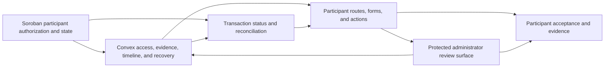

# Highrable Instawards Deliverable 3 — Three-Day Participant Interface Sprint Plan

## 1. Purpose and naming clarification

This plan centers on **Deliverable 3: Participant Dispute Interface** in Section 4.1 of the [Instawards SOW](./Highrable-Instawards-SOW.md) and schedules three days of coordinated work for the full four-person engineering team. The participant interface is the primary deliverable; the Soroban, Convex, and administrator-frontend workstreams provide the contract, data, authorization, review-state, and recovery boundaries needed to verify the participant workflow end to end.

This is not the same as the SOW's **Week 3** label, and it does not claim completion of the full contract, backend, administrator-interface, Testnet-validation, or reviewer-evidence deliverables.

The plan follows the structure of the [Deliverable 1 sprint plan](./Highrable-Instawards-Deliverable-1-Sprint-Plan.md) and is based on:

- The Deliverable 3 scope and Week 2–4 participant work in the SOW.
- The current participant routes and dispute feature slice under `apps/web/app/disputes/` and `apps/web/features/disputes/`.
- The current Convex dispute queries, mutations, authorization helpers, and regression suites.
- The current Soroban dispute state machine and the repository's documented wallet, transaction, deployment, and security boundaries.

This sprint is **baseline-aware**. Case creation, participant list/detail views, evidence and response actions, timeline rendering, marking-state feedback, route guards, and local frontend tests already exist. Every sub-sprint begins by comparing the planned behavior with current source and tests. Existing behavior must be hardened at a real uncovered boundary, integrated across layers, or evidenced through a distinct regression or acceptance test; it must not be duplicated merely to reach the commit target.

## 2. Three-day outcome

At the end of the sprint, the team will have:

1. **24 substantive code or test commits**, six planned per developer, within the requested 20–30 range.
2. Four role-specific branches with preserved attribution:
   - `instawards/dispute-contract`
   - `instawards/dispute-backend`
   - `instawards/dispute-admin-ui`
   - `instawards/dispute-participant-ui`
3. A participant-interface acceptance matrix covering case creation, evidence, responses, list/detail views, timeline, statuses, transaction links, access guards, validation, loading/error/retry states, responsive behavior, and tests.
4. A participant workflow that consumes the existing Convex types and state vocabulary without creating a competing frontend state machine.
5. Tested participant-role, parent-record, and related-record authorization checks for creation, reads, evidence, and responses at the Convex boundary, with the caller-possession limitation disclosed.
6. Clear on-chain marking states for simulation, signature, submission, confirmation, failure, uncertainty, reconciliation, and safe retry.
7. Local administrator-side integration coverage showing that participant cases and evidence reach the protected review surface and that administrator status or resolution changes use the contract consumed by the participant view.
8. Focused Soroban, Convex, participant, and administrator test reports plus an evidence package suitable for the Deliverable 3 pull request.

The SOW minimum for Deliverable 3 is at least four passing participant-interface tests. The repository already documents substantially broader local coverage, so this sprint records the actual current result and adds only distinct coverage that closes an identified gap. Five full Stellar Testnet lifecycles and the complete reviewer evidence package remain project-wide acceptance targets.

## 3. Commit accounting policy

The target is **24 substantive code/test commits**.

| Rule | Application |
| --- | --- |
| One sub-sprint equals one planned commit | Every `C01`–`C24` row below represents one coherent code or test commit. |
| Documentation is excluded | This plan, handoff notes, PR descriptions, screenshots, recordings, test reports, and vault updates do not count toward 24. |
| No duplicate work | If a behavior is already complete, the assigned developer must close a distinct uncovered edge case, integration boundary, accessibility defect, or regression risk in the same scope. |
| Baseline gate before every C-ID | The developer records the current source/test evidence and one concrete missing assertion or behavior before coding. Revalidation without a source/test delta is evidence work and does not count as a commit. |
| No artificial churn | Do not split one logical change into cosmetic commits. If no meaningful gap remains for a row, document that fact instead of manufacturing a commit. |
| Preserve attribution | Each developer commits only to the assigned role branch and records the matching C-ID in the branch or pull-request evidence. |
| Keep commits reviewable | Each commit must leave its owned package buildable or testable and must avoid unrelated workspace changes. |
| Protect generated and secret material | Do not hand-edit generated Convex files or commit `.env` files, private keys, seed phrases, session secrets, or provider tokens. |

## 4. Team ownership and dependency boundaries

| Developer | Sprint role | Branch | Primary ownership |
| --- | --- | --- | --- |
| Soroban Smart Contract Developer | Participant chain-action and state authority | `instawards/dispute-contract` | `contracts/escrow/`, dispute authorization/state/event tests, deployment compatibility, and participant marking invariants |
| Convex Backend Developer | Participant data, authorization, and recovery boundary | `instawards/dispute-backend` | `packages/backend/convex/disputes/`, related helpers and tests, evidence/response association, audit events, and chain-marking callbacks |
| Frontend Developer 1 — Administrator UI | Cross-interface review and resolution integration | `instawards/dispute-admin-ui` | `apps/web/app/admin/disputes/`, `apps/web/features/admin/`, protected review visibility, and admin-to-participant state handoff tests |
| Frontend Developer 2 — Participant UI | Deliverable 3 lead | `instawards/dispute-participant-ui` | `apps/web/app/disputes/`, `apps/web/features/disputes/`, participant routes, forms, timeline, transaction states, responsive behavior, and acceptance tests |

### Frontend sequencing and file-ownership rule

Frontend Developer 2 owns the Deliverable 3 participant feature slice. Frontend Developer 1 supports the sprint through the administrator surface and cross-interface acceptance path; they do not edit participant files unless Frontend Developer 2 explicitly hands off a named file.

Before `C07` and `C08` are complete, both frontend developers freeze a short integration handoff containing:

- Convex query and mutation names and argument/result types.
- Dispute review and on-chain status vocabulary.
- Loading, unauthorized, not-found, failed, uncertain, retryable, and terminal UI states.
- Participant-to-administrator evidence visibility and administrator-to-participant status propagation.
- File ownership for shared components and tests.

Any change to this contract after Day 1 requires review by the Convex developer and both frontend developers.

The handoff itself is documentation/evidence and does not count toward the 24 commits. The counted frontend work must be a substantive type adapter, component, route, or test change that enforces the handoff in code.

### Architecture boundaries to preserve

- Soroban remains authoritative for escrow status, funds, participant authorization for contract calls, and settlement outcome.
- Convex owns application dispute records, evidence relationships, responses, workflow events, notifications, transaction bookkeeping, and local reconciliation state.
- Participant UI types come from `@repo/convex-client`; the frontend must not duplicate Convex document shapes or invent additional persisted statuses.
- Direct contract calls stay in `apps/web/core/stellar`; feature components coordinate user experience and Convex phase recording.
- UI guards improve clarity but never replace trusted backend authorization.
- Participant mutations that accept a wallet argument do not, by themselves, prove private-key possession. This limitation must remain explicit unless a signed-session boundary is implemented and verified.
- A known or uncertain transaction hash must be reconciled, not blindly resubmitted.
- Live Testnet claims require matching network, contract ID, and deployed-code identity. Local tests and an old deployment artifact are not proof of current deployment behavior.

## 5. Execution flow



Each developer owns two candidate commits per day. Day 1 freezes the cross-layer contract and participant entry path. Day 2 completes evidence, responses, timeline, and protected review visibility. Day 3 hardens transaction recovery, synchronization, responsive/accessibility behavior, and acceptance evidence. A C-ID counts only after its baseline note identifies a real uncovered delta; otherwise it becomes evidence-only work and the final commit shortfall is disclosed.

## 6. Sprint Day 1 — Baseline, access contract, and case creation

**Goal:** freeze the cross-layer participant contract and prove that an eligible client or freelancer can enter the workflow without weakening authorization or duplicating current functionality.

| Sub-sprint / commit | Developer | Code/test commit scope | Done when |
| --- | --- | --- | --- |
| **C01** | Soroban Smart Contract Developer | Lock the participant-facing `mark_disputed` method, error, status, and event contract with typed Rust fixtures. | The client, assigned freelancer, administrator, eligible entry states, emitted fields, and rejected calls are explicit for backend and frontend consumers. |
| **C02** | Convex Backend Developer | Add or update participant API-contract tests for dispute queries, mutations, validators, result shapes, and status vocabulary. | The Deliverable 3 acceptance matrix maps to current public APIs and generated types without hand-editing generated files. |
| **C03** | Frontend Developer 1 — Administrator UI | Add a typed administrator consumer-contract test or adapter for newly created participant cases; publish the separate file-ownership handoff as evidence. | The code/test locks queue/detail fields, evidence data, status names, and forbidden result shapes; the documentation-only handoff is not counted as the commit. |
| **C04** | Frontend Developer 2 — Participant UI | Harden the participant list/detail route states and wallet-scoped query behavior. | Loading, disconnected, empty, denied, not-found, failed, and successful states render explicitly and stale wallet/case results cannot leak into the active view. |
| **C05** | Soroban Smart Contract Developer | Extend participant authorization and state-guard regression tests for `mark_disputed`. | Client and assigned freelancer calls succeed only from `Funded` or `Submitted`; unrelated, unassigned, terminal, and repeated calls fail without changing escrow state or balances. |
| **C06** | Convex Backend Developer | Complete the eligibility and case-creation matrix for roles, parent types, escrow states, duplicate cases, and related-record conflicts. | Accepted creation derives canonical participants and parent links; every rejected case leaves dispute, evidence, event, notification, and parent records unchanged. |
| **C07** | Frontend Developer 1 — Administrator UI | Verify that a valid participant-created case enters the protected administrator queue/detail surface with correct participant and parent context. | Authorized administrators see the case; forbidden, stale, missing, or conflicting records remain protected and produce explicit UI states. |
| **C08** | Frontend Developer 2 — Participant UI | Complete case-creation validation and the create/mark workflow against the frozen Convex and Soroban contracts. | Eligible work can open a case; field, parent, permission, pending, simulation, signing, backend-write, and recoverable marking failures preserve an understandable participant state. |

**Day 1 exit gate:** `C01`–`C08` are pushed; the API/status/file-ownership handoff is frozen; case creation is covered from eligibility through the saved dispute record; and no UI or backend path claims wallet-possession proof beyond its implemented trust boundary.

## 7. Sprint Day 2 — Evidence, responses, timeline, and review visibility

**Goal:** make participant evidence and communication complete, protected, auditable, and visible to the correct administrator workflow.

| Sub-sprint / commit | Developer | Code/test commit scope | Done when |
| --- | --- | --- | --- |
| **C09** | Soroban Smart Contract Developer | Add event-payload regression coverage for participant dispute marking. | Tests lock the current `dispute`/`marked` topic with `escrow_id` and the event data's `version`, `actor`, and final `status`, without inventing prior-state fields or assuming a general event indexer exists. |
| **C10** | Convex Backend Developer | Harden evidence association and protected reads for attachments, submissions, revisions, messages, and deadlines. | Every reference belongs to the same work and permitted participant, raw and deduplicated limits are enforced, and unauthorized or invalid input rolls back atomically. |
| **C11** | Frontend Developer 1 — Administrator UI | Complete protected evidence rendering for participant-submitted evidence and linked records. | Authorized reviewers can distinguish available, missing, blocked, deleted, invalid, and retryable evidence without exposing protected content to a denied session. |
| **C12** | Frontend Developer 2 — Participant UI | Complete participant evidence submission with validation, upload/reference ownership, draft preservation, and retry states. | Allowed evidence submits once; invalid, revoked, stale-session, upload, and backend failures keep safe recoverable form state and accessible errors. |
| **C13** | Soroban Smart Contract Developer | Add no-side-effect regression tests for repeated or invalid participant marking calls. | Rejected calls preserve escrow storage, balances, reputation state, and event counts across both eligible entry states and all terminal outcomes. |
| **C14** | Convex Backend Developer | Harden participant response permissions, audit-event creation, timeline ordering, and notification side effects. | Only current participants can respond to a nonterminal case; accepted writes create one response event and the intended notification, while replay/rejection does not duplicate effects. |
| **C15** | Frontend Developer 1 — Administrator UI | Verify administrator review/status actions propagate through the frozen state contract consumed by the participant detail view. | Review-state changes preserve role and audit context and do not require either frontend to translate through a second status model. |
| **C16** | Frontend Developer 2 — Participant UI | Complete response composition and the participant timeline/status/transaction presentation. | Responses preserve drafts across recoverable failures; all event actor roles, optional status transitions, attachments, transaction links, loading, empty, and retry states are readable. |

**Day 2 exit gate:** `C09`–`C16` are pushed; participant evidence and responses are permission-checked at the backend; the administrator surface can review the submitted context; and both frontends render the same Convex status and event vocabulary.

## 8. Sprint Day 3 — Transaction recovery, synchronization, and acceptance

**Goal:** close the three-day local implementation/test slice with safe chain-state feedback, cross-interface synchronization, responsive/accessibility coverage, and reviewer-ready evidence.

| Sub-sprint / commit | Developer | Code/test commit scope | Done when |
| --- | --- | --- | --- |
| **C17** | Soroban Smart Contract Developer | Extend generic Soroban `Address` authorization and argument-invariant coverage for participant marking. | Rust tests remain wallet-transport agnostic and prove only contract-level actor authorization; browser classic-source and passkey transaction construction are left to the frontend integration task. |
| **C18** | Convex Backend Developer | Complete participant marking callback and reconciliation coverage for started, succeeded, failed, duplicate, stale, conflicting, late-success, and known-hash cases. | Confirmed data is never overwritten, hashless failure can retry safely, known or uncertain transactions wait for reconciliation, and side effects occur once. |
| **C19** | Frontend Developer 1 — Administrator UI | Add a protected cross-interface acceptance test from participant case creation/evidence through administrator review. | The administrator receives the right case and evidence, an unauthorized reviewer is rejected, and review-state changes are observable through the agreed contract. |
| **C20** | Frontend Developer 2 — Participant UI | Complete marking-status, explorer-link, uncertainty, reconciliation, safe-retry, and external-wallet/passkey transaction-construction coverage. | Simulation, signing, submission, confirmation, Convex recording, known-hash uncertainty, failure, retry, and confirmed states are distinct; links use validated hashes and the configured network; passkey addresses are not used as classic source accounts. |
| **C21** | Soroban Smart Contract Developer | Add or update a repeatable, non-deploying contract deployment-identity verification fixture for the selected Testnet scope. | The check compares network, contract ID, local build provenance, deployed code identity, and reciprocal contract links before live evidence is claimed; it does not execute or prove a participant flow. |
| **C22** | Convex Backend Developer | Add the final participant acceptance matrix for access revocation, stale wallet/case reads, evidence/response rollback, parent isolation, and terminal states. | Client and freelancer paths pass; unrelated or revoked actors cannot read or write; micro-gig and milestone parents remain isolated; rejected operations leave complete snapshots unchanged. |
| **C23** | Frontend Developer 1 — Administrator UI | Add administrator resolution-result contract coverage for client refund, freelancer payout, and split outcomes. | The protected admin callback/result exposes the exact Convex terminal status and transaction identity expected by the participant consumer; stale or failed settlement cannot publish false success. |
| **C24** | Frontend Developer 2 — Participant UI | Complete responsive, accessibility, and participant acceptance tests, including rendering the C23 terminal-result contract. | Case creation, list/detail, evidence, responses, timeline, guards, transaction feedback, retry, and all three terminal outcomes work at supported breakpoints with keyboard access, labels, focus/error recovery, and no required test failures. |

**Day 3 exit gate:** `C17`–`C24` are pushed; focused contract, backend, participant, and administrator suites pass; the participant PR maps the full Deliverable 3 acceptance matrix to source and tests; and live-chain claims are made only when deployment identity and transaction evidence are actually verified.

## 9. Developer commit distribution

| Developer | Role branch | Commits | IDs | Planned role evidence |
| --- | --- | ---: | --- | --- |
| Soroban Smart Contract Developer | `instawards/dispute-contract` | 6 | `C01`, `C05`, `C09`, `C13`, `C17`, `C21` | Method/event contract, participant authorization and state guards, no-side-effect invariants, wallet-path assumptions, deployment identity fixture |
| Convex Backend Developer | `instawards/dispute-backend` | 6 | `C02`, `C06`, `C10`, `C14`, `C18`, `C22` | API contract, eligibility/creation, evidence and responses, timeline effects, callback/reconciliation, participant acceptance matrix |
| Frontend Developer 1 — Administrator UI | `instawards/dispute-admin-ui` | 6 | `C03`, `C07`, `C11`, `C15`, `C19`, `C23` | Cross-interface handoff, protected case/evidence visibility, review-state propagation, admin/participant acceptance and terminal synchronization |
| Frontend Developer 2 — Participant UI | `instawards/dispute-participant-ui` | 6 | `C04`, `C08`, `C12`, `C16`, `C20`, `C24` | Participant routes, creation/marking, evidence/responses, timeline, transaction recovery, responsive/accessibility acceptance |
| **Total** | **4 role branches** | **24** | `C01`–`C24` | **20–30 requested code/test commits satisfied** |

Each day assigns two commits to every developer. Frontend Developer 2 owns the primary Deliverable 3 pull request; the other three pull requests provide attributable integration changes and evidence needed to validate it.

## 10. Validation and evidence gates

### Per-commit checks

- Soroban commits run focused Rust tests for participant authorization, state transitions, event shape, balance/storage preservation, and invocation assumptions.
- Convex commits validate arguments, participant and parent relationships, permission changes, atomic rollback, audit/notification counts, and idempotent transaction phases.
- Participant frontend commits run focused component/integration tests for route guards, validation, forms, timeline, accessibility, transaction states, and stale-session behavior.
- Administrator frontend commits run protected-session and cross-interface tests without weakening the signed-session, configured-admin-wallet, and Convex-secret boundaries.
- Every direct chain path simulates before submission, validates the configured network/contract scope, and records local phases separately from authoritative chain results.

### Day 3 planned validation

Run the focused suites first, then the relevant full package checks:

```bash
cd contracts && cargo test
pnpm --filter @repo/backend test
pnpm --filter web test
pnpm --filter @repo/backend lint:fix
pnpm --filter web lint:fix
pnpm --filter web build
pnpm contracts:test:identity
```

`pnpm contracts:verify:identity` is a read-only network verification only when explicit backend-scope and matching build-provenance inputs are available. Do not run a deployment command merely to validate this document or satisfy a checklist.

The evidence report must record the exact commands, current totals, failures, and environment limitations. Local deterministic or mocked tests must not be described as live browser-to-Convex, wallet, RPC, or Testnet proof.

### Evidence to collect

1. Four branch URLs and the `C01`–`C24` commit mapping.
2. The substantive Deliverable 3 participant pull request plus the three supporting role pull requests.
3. The participant acceptance matrix linking each SOW requirement to source files, tests, and results.
4. Focused and full Soroban, Convex, participant, and administrator test output.
5. Screenshots at representative desktop and mobile widths for list, creation, detail, evidence, response, timeline, failure/retry, and terminal states.
6. A short recording of the participant flow and protected administrator handoff in the reviewer environment.
7. Verified Testnet network, contract identity, and Stellar Expert transaction links only for flows actually executed against the matching deployment.
8. A concise known-gaps list covering participant identity proof, deployment identity, mocked transports, and any unavailable live evidence.

Documentation and evidence are required for reviewer clarity but do not count toward the 24 code/test commits.

## 11. Three-day implementation-slice exit criteria

The three-day Deliverable 3 implementation slice is ready for **engineering review** when:

- [ ] `C01`–`C24` are substantive code/test commits, six per developer, or any meaningful shortfall is explained without artificial commits.
- [ ] All four role branches contain attributable work and have substantive pull requests.
- [ ] Every sub-sprint commit is owned by the developer named in its row and stays within the listed file and trust boundaries.
- [ ] The participant branch and pull request map every Deliverable 3 requirement to source and test evidence.
- [ ] Eligible clients and freelancers can create a case with validated work and evidence context.
- [ ] Participant case list/detail, evidence, responses, timeline, status, and transaction links consume the current Convex contract and handle all required route states.
- [ ] Unrelated, revoked, stale, or terminal actors cannot read or write protected case data.
- [ ] Evidence and response rejection is atomic and preserves safe participant draft state.
- [ ] Marking success, failure, uncertainty, late success, reconciliation, and retry are distinguishable and idempotent.
- [ ] Administrator review-state and terminal resolution changes synchronize back to the participant surface without false success.
- [ ] Participant views are responsive and meet the planned keyboard, label, focus, and error-recovery checks.
- [ ] At least the SOW minimum of four participant-interface tests pass; the actual focused and full suite totals are recorded with zero required failures.
- [ ] The project-wide test report also records whether at least 20 automated tests pass with zero required failures; historical totals from different snapshots are not added together.
- [ ] Any Testnet claim includes matching deployment/code identity and real transaction evidence.
- [ ] No secrets, private keys, local environment files, generated Convex output, or unrelated changes are included.

Formal SOW Deliverable 3 completion additionally requires all evidence listed in Section 6.1 of the SOW: the participant branch and weekly history, a **merged** substantive participant pull request, source links, frontend test output, a reviewer-accessible deployment, screenshots, and a recording. Until those items are present, this document supports engineering readiness only and must not be used to claim the SOW deliverable complete.

## 12. Deferred or outside this three-day sprint

- Full completion of Deliverables 1, 2, and 4; this plan includes only the supporting contract, backend, and administrator integration work listed above.
- A general Soroban event indexer or historical event-ingestion service.
- A new participant authentication architecture unless separately approved; current caller-supplied wallet limitations must remain disclosed.
- Five complete Testnet dispute lifecycles and all five Stellar Expert links unless the matching deployment and environment are available during this sprint. A reviewer deployment, screenshots, recording, and merged participant pull request remain mandatory before formal SOW Deliverable 3 completion even when they are finished after this three-day implementation slice.
- Production settlement, real funds, third-party security audit, automated judgment of evidence, native mobile work, multi-chain support, or unrelated marketplace features.
- Contract deployment or environment switching performed solely to satisfy the sprint-plan checklist.

## 13. Known decisions and risks

1. **Existing participant maturity:** Most Deliverable 3 surfaces already exist. The first task in every row is to compare the baseline with the acceptance matrix. Meaningful integration and regression gaps take priority over adding parallel components.
2. **Participant identity boundary:** Some public Convex participant functions still accept caller-supplied wallet addresses. Role and parent checks are necessary but are not cryptographic proof that the caller controls the wallet.
3. **Two-frontend coordination:** Frontend Developer 2 owns participant files; Frontend Developer 1 owns administrator files. Cross-interface contracts are frozen on Day 1 to avoid conflicting edits and divergent status models.
4. **Chain authority and uncertainty:** Soroban owns escrow truth. A browser success message or local callback cannot independently establish settlement, and known-hash uncertainty must use verification/reconciliation rather than resubmission.
5. **Deployment identity:** Existing deployment records may predate current dispute-admin and event changes. Live evidence is valid only after the selected Testnet contract is matched to the tested source/build and backend scope.
6. **Local-test limitations:** Current participant and administrator tests use controlled wallet, upload, Convex, and RPC seams. They are valuable regression evidence but do not prove a live reviewer deployment or signed Testnet transaction.
7. **Commit target:** Twenty-four commits are planned because it divides evenly across four developers and three days. Meaningful work remains the governing rule; do not inflate the history when the baseline already satisfies a row completely.
8. **Branch provenance:** Deliverable 2 evidence records that later work was integrated locally on `instawards/dev/sherwin` under a single-branch override and that the proposed four role branches/PRs were not yet proven complete. Before Day 1, map existing commits to the four target branches and preserve authorship through reviewed cherry-picks or rebases; do not duplicate already-landed work to manufacture clean histories.
